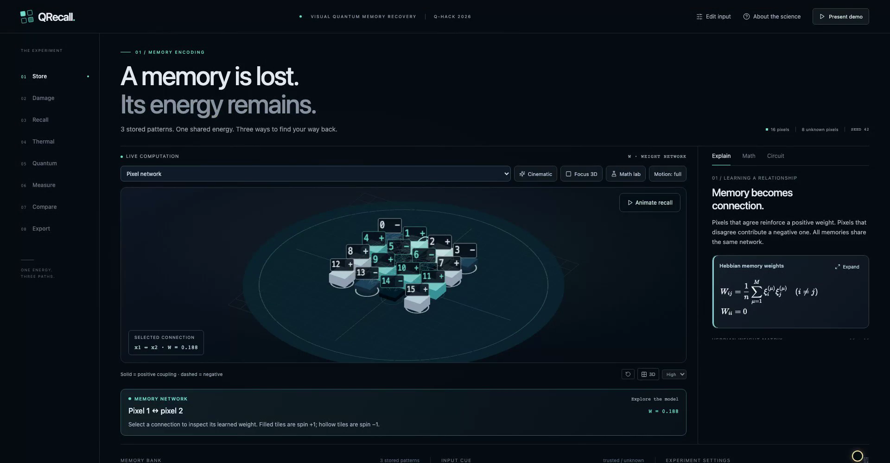
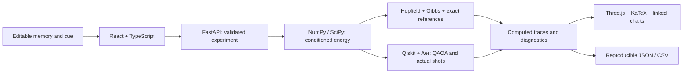

<div align="center">

# QRecall

### See how a memory finds its way back.

An interactive laboratory connecting associative memory, thermal sampling and quantum circuits through one shared energy model.

[**Launch the live demo**](https://qrecall.graysea-2c087476.eastasia.azurecontainerapps.io/) · [Quick tour](docs/QUICK_TOUR.md) · [Mathematical specification](MATH_SPEC.md) · [Measured results](docs/BENCHMARK.md)

[](https://github.com/Siddhanthkjain2005/QRecall/actions/workflows/ci.yml)


</div>



## Why QRecall?

Memory-recovery algorithms often produce an answer without revealing how they reached it. Quantum explanations can be equally disconnected: a circuit diagram, a probability plot and an equation rarely refer to the same inspectable experiment.

QRecall links them. Store binary patterns, erase or corrupt a cue, then follow the actual computation from pixels to weighted connections, local fields, conditioned energy, Ising Hamiltonian, gates and measured reconstruction. Pause at any step and inspect the numbers behind the animation.

The intended audience is students, educators and developers investigating small energy-based models. This prototype supports learning and algorithm inspection; it is not a production image-restoration system.

## What you can explore

| Feature | What it reveals |
|---|---|
| **Editable memory bank and cue** | Signed Hebbian weights, trusted erasures and soft noisy observations. |
| **Hopfield recall** | Asynchronous updates, neighbor contributions, local fields and actual energy changes. |
| **Gibbs sampling** | Temperature-dependent probabilities, seeded draws, uphill moves and an exact thermal reference. |
| **QAOA circuit playback** | Real Qiskit cost/mixer operations, complex amplitudes, relative phases and interference. |
| **Finite-shot measurement** | Actual Aer shot-memory prefixes, cumulative histograms, modal reconstructions and ties. |
| **Interactive Math lab** | Encoding, energy decomposition, Argand diagrams, expectation, variance, basis entropy and inverse participation. |
| **Linked 3D views** | Pixel networks, signed-weight sculptures, energy terrain and energy/phase/measurement constellations. |
| **Experiment controls** | Seeds, temperature, circuit depth/angles, bounded optimization, simulator noise and cancellable jobs. |
| **Comparison and provenance** | Nearest-memory baseline, exact diagnostics, reproducible scenarios, saved/live benchmarks and JSON/CSV exports. |
| **Presentation and accessibility** | Step/scrub/speed, cinematic camera, Focus 3D, presenter mode, expanded formulas, reduced motion and 2D fallback. |

## Try it in three minutes

1. Open the [live demo](https://qrecall.graysea-2c087476.eastasia.azurecontainerapps.io/) and select **Easy recall** from **Scenario**. Wait for **LIVE COMPUTATION**.
2. On **Store**, inspect a memory and a matrix cell. On **Damage**, use **Edit input** to erase or restore a pixel.
3. Press **Play recall**. Pause an update; inspect its local field and energy, then step forward.
4. Open **Thermal** and play its sampling trace. Open **Quantum**, play the gates and compare a cost operation with a mixer operation.
5. Open **Measure** to watch actual simulated shots accumulate. Use **Math lab** and **Expand** to inspect the equations.
6. Visit **Compare**, including the **Quantum worse** scenario, then **Export** to download the actual experiment.

Use **1–8** for chapters, **Space** for play/pause and arrow keys to step. Shortcuts leave text inputs alone. **Present demo** starts a simplified presentation; **Escape** exits. The [quick tour](docs/QUICK_TOUR.md) explains the controls and visual mappings.

## Run locally

**Requirements:** Python **3.12**, Node.js **22** and npm. No cloud account, API key or quantum hardware is required.

```sh
git clone https://github.com/Siddhanthkjain2005/QRecall.git
cd QRecall
python3.12 -m venv .venv
.venv/bin/python -m pip install -r backend/requirements.lock.txt
npm ci
npm run dev
```

Open **http://127.0.0.1:5173**. The launcher starts Vite on **5173** and FastAPI on **8000**, checks occupied ports and waits for the scientific engine. **Ctrl+C** stops both processes. Restart after changing Python code.

On Windows, create the environment with `py -3.12 -m venv .venv`, then install Python dependencies with `.venv\Scripts\python.exe -m pip install -r backend/requirements.lock.txt`. The npm commands are identical.

Installation requires internet access. Once installed, the interface, fonts, solvers, presets and recorded evidence operate locally. External source links are optional reading.

| Local endpoint | Purpose |
|---|---|
| `http://127.0.0.1:8000/api/health` | Engine status, runtime versions and problem limits |
| `http://127.0.0.1:8000/api/docs` | Interactive API schemas |
| `http://127.0.0.1:8000/api/openapi.json` | Machine-readable API contract |
| `http://127.0.0.1:8000/api/benchmarks/recorded` | Saved evidence with original provenance |

### Container

```sh
docker build -t qrecall .
docker run --rm -p 8000:8000 qrecall
```

Open **http://127.0.0.1:8000**. The container serves the interface and API together as an unprivileged user, using one worker. `npm run preview` previews only the frontend build; use the full launcher or container for scientific computation.

## Architecture



Rendering consumes solver outputs; it does not implement scientific updates. Revision tracking rejects stale results after input changes. Evaluation receives the source-memory identity separately; solvers and the optimizer do not. See [architecture and design](docs/ARCHITECTURE.md).

## Scientific model

Bits and spins use **sᵢ = 1 − 2xᵢ**: filled pixels are **spin +1 / bit 0**. Stored memories produce symmetric, zero-diagonal Hebbian weights normalized by the **total pixel count**. All methods use:

$$E(s) = -\frac{1}{2}s^TWs - b^Ts.$$

Trusted observations stay clamped. Eliminating them produces the conditioned Ising model without changing energy. Noisy observations add reliability-weighted **soft fields** and remain free to change.

Each free pixel maps to one qubit, with at most **eight free qubits / 256 enumerated states**. Qiskit executes cost then mixer gates; Aer supplies measured shots. Gibbs and QAOA reconstruct the **modal sampled state**, resolving count ties by the lowest basis integer.

The [mathematical specification](MATH_SPEC.md) covers conditioning, gate signs, bit order, tie rules, noise and diagnostics. [Primary sources](docs/SOURCES.md) provide the underlying references.

## Measured evidence

Two independently generated **12-case** batches use the same bank and declared budgets. Scenario curation uses a separate seed and does not contribute to these aggregates.

| Method | Batch 1 · seed 7102026 | Batch 2 · seed 7102027 |
|---|---:|---:|
| Nearest stored memory | **11 / 12** | **12 / 12** |
| Hopfield | 10 / 12 | 11 / 12 |
| Gibbs sample mode | 9 / 12 | 11 / 12 |
| QAOA sample mode | 5 / 12 | 10 / 12 |

All methods preserved trusted constraints in both batches. QAOA used depth one, up to **24 ideal-energy optimizer evaluations** and **1,024 Aer shots per case**. Per-case configurations, counts, decisions, resources, source digests and uncertainty intervals are in [`results/`](results/) and the [benchmark report](docs/BENCHMARK.md).

These small simulator experiments establish **no quantum advantage or hardware speedup**. Nearest-memory retrieval performs strongly; lower energy can still recover the wrong source. Correlated Gibbs draws and finite circuit shots are not independent benchmark cases. With device noise, phase playback describes the ideal circuit and measurements use the noisy simulation. Basis entropy measures distribution spread, not entanglement or recovery confidence.

## Validation

```sh
.venv/bin/python -m pip check
.venv/bin/python -m pytest backend/tests tests -q
npm test
npm run build
```

The scientific/API suite contains **166 tests** and the frontend suite **49 tests**, covering energy conditioning, invariant preservation, gate signs, bit order, normalization, seeded replay, real measurement prefixes, evaluation isolation and presentation behavior. The build includes TypeScript checking. GitHub Actions runs these checks on pushes and pull requests.

Optional browser regression tests:

```sh
npx playwright install chromium
npm run test:browser
```

Recorded local acceptance covers 104 feature scenes with real cursor interaction, including 3D, Math lab, formulas, playback, parameter edits, jobs, benchmarks and import/export. This evidence is distinct from the portable browser suite and public deployment checks. The [validation record](docs/VALIDATION.md) separates executed checks from pending work.

Known boundary: an extreme imported bias such as `1e308` can overflow computation and return an API error. Intended demonstrations use bounded small-model parameters. Automatic reconnection and the complete portable browser suite require separate acceptance checks.

To regenerate scientific artifacts after changing the core:

```sh
.venv/bin/python -m backend.generate_results
```

The generator preserves declared seeds and budgets, recomputes actual results and replaces their source digests. Run the recorded-results tests afterward.

## Repository map

| Location | Responsibility |
|---|---|
| `backend/core/` | Model, conditioning, classical/quantum solvers, diagnostics and evaluation |
| `backend/main.py`, `backend/schemas.py` | Validated API, provenance and bounded jobs |
| `src/` | Interface, 3D scenes, equations, charts and playback |
| `backend/tests/`, `tests/` | Scientific, API, frontend and browser checks |
| `results/` | Generated presets and independent benchmark JSON/CSV |
| `docs/` | Quick tour, architecture, primary references and validation |
| `.github/workflows/ci.yml` | Automated Python/frontend/build checks |

See [CONTRIBUTING.md](CONTRIBUTING.md) for development conventions. Dependencies, credentials, local recordings and generated presentation packages are excluded from Git.
