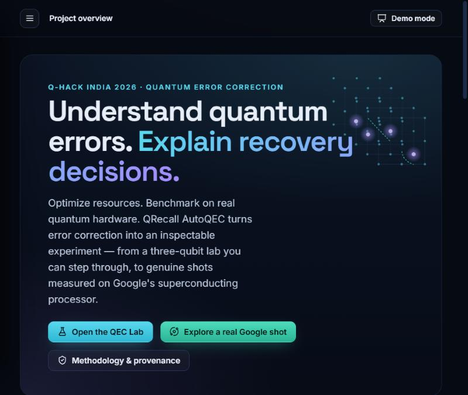
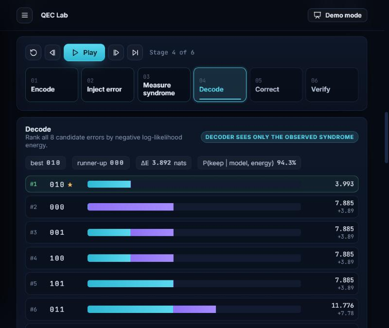
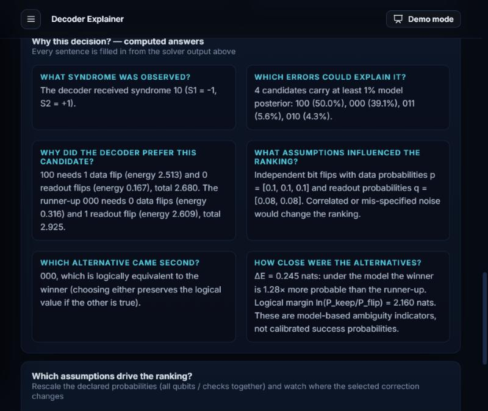
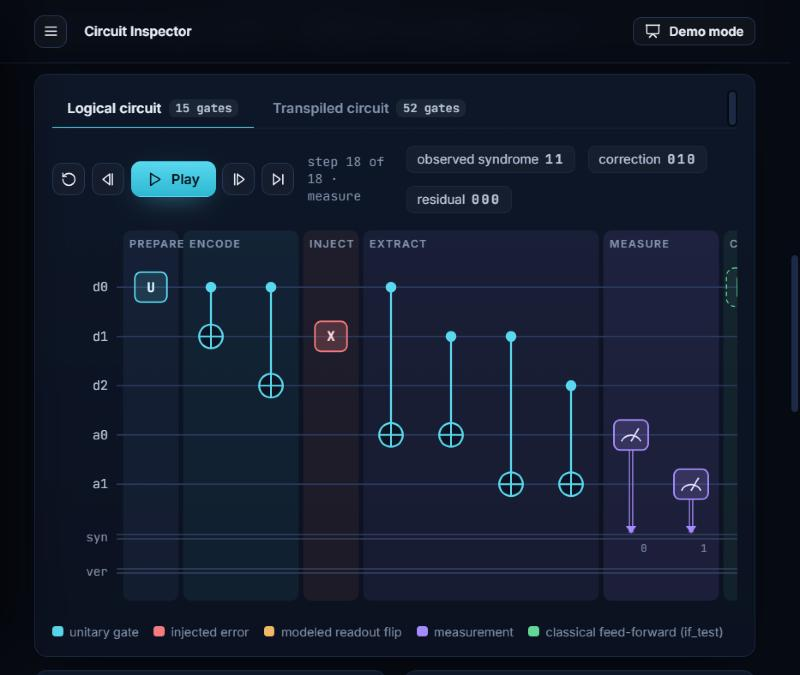
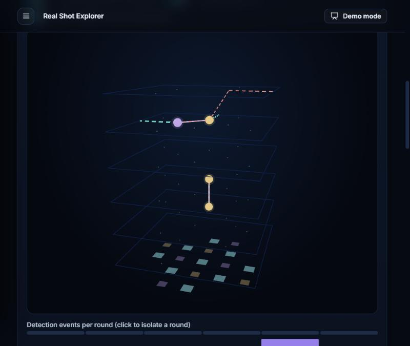

<div align="center">

# QRecall AutoQEC

### Understand quantum errors. Explain recovery decisions. Optimize resources. Benchmark on real quantum hardware.

An interactive, scientifically defensible quantum error-correction laboratory — from a three-qubit code you can
step through gate by gate, to genuine shots measured on Google's superconducting processor.

[Scientific documentation](docs/autoqec/SCIENCE.md) · [Dataset pipeline](docs/autoqec/DATASET.md) · [API](docs/autoqec/API.md) · [Judge demo](docs/autoqec/DEMO_GUIDE.md) · [Engineering report](docs/autoqec/ENGINEERING_REPORT.md) · [Architecture](docs/autoqec/ARCHITECTURE.md)


</div>



## What it is

Quantum error correction protects a logical qubit with many physical qubits and repeated parity checks
(syndromes). A decoder turns syndromes into a correction — usually as a black box. AutoQEC makes that
decision inspectable, tests whether its explanations are trustworthy, and validates the ideas on Google
Quantum AI's published hardware data.

| Module | What it shows | Data |
|---|---|---|
| **1 · QEC Interactive Studio** | *How* decoding works: three-qubit bit-flip code, explicit likelihood (energy) decoder, exact references, circuits and resource trade-offs | Simulation (Qiskit statevector / Aer, seeded) |
| **2 · Google Hardware Analyzer** | *How* decoding performs on real hardware: PyMatching vs exact Ising/QUBO vs Google's decoders, shot by shot | Google's 131 published surface-code experiments, 7,000,000 shots |

### Module 1 — QEC Interactive Studio
* **QEC Lab** — Encode → Inject → Measure → Decode → Correct → Verify with a real Qiskit circuit: choose the
  logical state, inject X/Y/Z faults, add seeded data and readout noise, compare four decoders on the same
  syndrome, use physical feed-forward or a Pauli-frame update, and verify with a coherent majority decoder.
* **Message Lab** — type a message; each UTF-8 bit is carried in a repetition-code block next to an
  unprotected copy hit by the same physical flips. Animated, clickable down to the bit, never forced to succeed.
* **Circuit Inspector** — step through the actual circuit (mid-circuit measurement, `if_test` feed-forward),
  inspect the statevector after every gate, compare with the transpiled circuit and an independent Aer run.
* **Decoder Explainer** — any syndrome, any declared model, d = 3/5/7: every candidate's data and readout
  energy terms, rank, posterior, logical-class probabilities, computed Q&A and decision-boundary sensitivity.
* **Resource Optimizer** — 59 verified compilations of the *same* task, Aer logical-failure estimates with
  Wilson intervals, hard constraints, normalized cost `J = wQ·Q/Qref + wG·G2/G2ref + wD·D/Dref`, Pareto view.
* **Simulation Benchmarks** — failure curves, readout robustness, oracle agreement, held-out tests of whether
  energy gaps predict failures, calibration under matched and mismatched models, runtime, reproducibility.

### Module 2 — Google Hardware Analyzer
* **Dataset Explorer** — 131 experiments with provenance, Google's layout diagrams, DEM statistics and a
  one-click shot-for-shot reproduction of Google's PyMatching predictions.
* **Real Shot Explorer** — a single real shot as a rotatable 3D space-time lattice (with a 2D fallback):
  fired detectors, PyMatching's matched edges, the Ising decoder's inferred mechanisms and the best
  opposite-outcome explanation, with the recorded logical flip shown separately as the answer key.
* **Decoder Benchmarks** — failure vs rounds, fitted logical error per round, distance comparison, paired
  McNemar verdicts, noise-aware vs uniform ablation, held-out ambiguity test, agreement and latency.
* **Failure Investigator** — disagreements, all-decoders-wrong shots, confident failures, drilled to the shot.
* **Configuration Advisor** — recommends only experimentally tested configurations, or answers
  "No tested configuration meets these constraints."

Plus a methodology & provenance page, sources & limitations, and a 10-beat **presenter mode**.

| QEC Lab: energy-ranked candidates | Decoder Explainer: computed answers |
|---|---|
|  |  |
| **Circuit Inspector: the real Qiskit circuit** | **Real Shot Explorer: one Google hardware shot** |
|  |  |

## Headline evidence

* **Data integrity:** for all 131 experiments, detection events and observable flips re-derived from Google's
  raw measurements match the published files bit-for-bit (archive MD5 verified against Zenodo).
* **Baseline reproduction:** PyMatching 2.4 reproduces Google's published PyMatching predictions shot-for-shot
  in 73/131 experiments; in the rest, every probed disagreement (53/53) is a near-degenerate shot where our
  answer equals the exact minimum-weight optimum and the 2022 run's does not.
* **Published result reproduced:** fitting Google's tensor-network predictions gives **2.914 %** (d = 5) vs
  **3.028 %** (d = 3) logical error per round — the values reported in *Nature* 614, 676 (2023).
* **Exact Ising/QUBO decoding on 128,000 real shots** (28 short experiments; held-out pij models): 7.20% logical
  failure vs 8.36% for PyMatching with the same models (significantly fewer failures in 18 of 28 experiments,
  never significantly more) — while **Google's tensor-network decoder stays ahead** (7.03%). Uniform weights:
  9.26%. Details in the [engineering report](docs/autoqec/ENGINEERING_REPORT.md#3-results).
* **Explanations tested, not assumed:** on held-out simulated trials the energy gap separates failures with
  AUROC 0.81 and the model posterior is calibrated (ECE 0.002) — but only when the noise model is right
  (ECE 0.029 under mismatch).

**Not claimed:** quantum advantage, hardware speedup, a new decoding algorithm, hardware-validated circuit
optimization, or a physical diagnosis from a syndrome. Energy/Ising decoding, matching and noise-aware
likelihoods are prior research; our contribution is the integrated, explainable, reproducible system.

## Run locally

Requirements: Python **3.12**, Node.js **22+**, npm. The real-data subset ships with the repository, so the
whole app works offline after installation.

```sh
git clone https://github.com/Dinesh373737/QRECALL-AUTOQEC.git
cd QRECALL-AUTOQEC
python3.12 -m venv .venv
.venv/bin/python -m pip install -r backend/requirements.lock.txt
npm ci
npm run dev
```

On Windows: `py -3.12 -m venv .venv` and `.venv\Scripts\python.exe -m pip install -r backend/requirements.lock.txt`.

Open **http://127.0.0.1:5173**. The launcher starts FastAPI on port 8000 and Vite on 5173 (first start can take
a minute while Qiskit, Stim and PyMatching load). API docs: http://127.0.0.1:8000/api/docs.

### Full Google archive (optional, 315 MB)

```sh
python -m backend.hardware.pipeline fetch      # download from Zenodo, verify MD5, extract safely
python -m backend.hardware.pipeline baseline   # all 7,000,000 shots, PyMatching x3 + Google decoders
python -m backend.hardware.pipeline ising      # exact Ising/QUBO on the short experiments (hours; --resume)
python -m backend.hardware.pipeline probe      # PyMatching disagreement probe
python -m backend.generate_qec_results         # Module 1 recorded benchmarks and optimizer runs
```

With the archive extracted the API uses all shots for live analysis; without it, it uses the subset.

### Container

```sh
docker build -t qrecall-autoqec .
docker run --rm -p 8000:8000 qrecall-autoqec
```

Open http://127.0.0.1:8000. The image serves the interface, the API and the real-data subset.

## Validation

```sh
.venv/bin/python -m pip check
.venv/bin/python -m pytest backend/tests tests -q
npm test
npm run build
```

Python: 252 tests (the original 166 plus 86 AutoQEC tests covering syndrome tables, exact energies,
tie-breaking, the recovery convention, Bayes reference, seeds, messages, circuits and Aer agreement,
optimizer constraints, Google file parsing against Stim, shot alignment, PyMatching reproduction, held-out
partitioning, Ising MILP vs brute force, QUBO equivalence, timeout handling, per-round fits, the published
reproduction and the advisor). Frontend: 56 unit tests; the production build type-checks everything.

## The original QRecall

The associative-memory laboratory (Hopfield, Gibbs, QAOA) is preserved unchanged at `/legacy.html`; its
documentation remains in [`docs/`](docs/) and [`MATH_SPEC.md`](MATH_SPEC.md).

## Data license and citation

Google Quantum AI, *Data for "Suppressing quantum errors by scaling a surface code logical qubit"*, Zenodo
(2022), doi:10.5281/zenodo.6804040, CC-BY-4.0; and Google Quantum AI, *Nature* 614, 676–681 (2023).
`data/google_subset` is a verbatim subset (real shots only) with a SHA-256 manifest.
