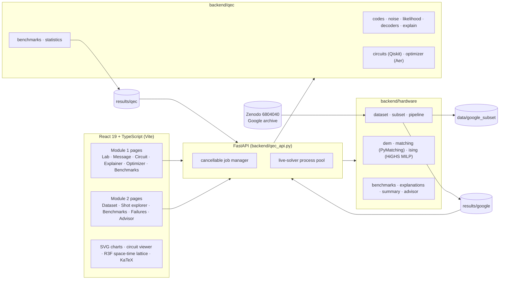

# Architecture

## Principles

* **Scientific computation lives in Python.** The UI renders typed payloads; explanations are assembled
  from solver output, never written by hand. When the backend is unavailable the UI shows an explicit
  offline state instead of placeholder numbers.
* **Provenance travels with every number.** Payloads carry seeds, model parameters, data sources,
  shot ranges, partitions and versions; recorded artifacts are served with their SHA-256.
* **Long work never blocks interaction.** Optimizer evaluations, benchmark reruns and reproduction runs
  are background jobs with progress and cancellation. Live exact MILP solves run in a separate process
  pool so they cannot hold the API's interpreter lock.
* **Two layouts, one interface.** `backend.hardware.dataset.Catalog` serves either the full extracted
  archive or the deployable real-shot subset through the same API.

## Repository map (AutoQEC parts)

| Path | Responsibility |
|---|---|
| `backend/qec/codes.py` | Repetition codes, syndromes, recovery convention |
| `backend/qec/noise.py` | Seeded independent data/readout noise |
| `backend/qec/likelihood.py` | Energies, candidate ranking, logical classes |
| `backend/qec/decoders.py` | None / lookup / energy / exact Bayes reference |
| `backend/qec/explain.py` | Computed Q&A explanations and sensitivity |
| `backend/qec/experiment.py`, `message.py` | QEC Lab trial and Message Lab orchestration |
| `backend/qec/circuits.py` | Qiskit circuits, statevector stepping, metrics, transpilation |
| `backend/qec/optimizer.py` | Candidate compilations, verification, p_L, constraints, J, Pareto |
| `backend/qec/benchmarks.py`, `statistics.py` | Module 1 benchmarks; shared statistics |
| `backend/hardware/dataset.py`, `subset.py`, `pipeline.py` | Archive verification, parsing, subset, CLI |
| `backend/hardware/dem.py`, `matching.py`, `ising.py` | DEM hypergraphs, PyMatching, Ising/QUBO MLE |
| `backend/hardware/benchmarks.py`, `summary.py` | Real-data evaluation, fits, paired statistics, verdicts |
| `backend/hardware/explanations.py`, `advisor.py` | Per-shot evidence; tested-configuration advisor |
| `backend/qec_api.py`, `backend/qec_schemas.py` | HTTP routes and request contracts |
| `src/autoqec/` | The AutoQEC interface (pages, components, charts, lib) |
| `src/App.tsx` … via `legacy.html` | The original QRecall memory lab, preserved |
